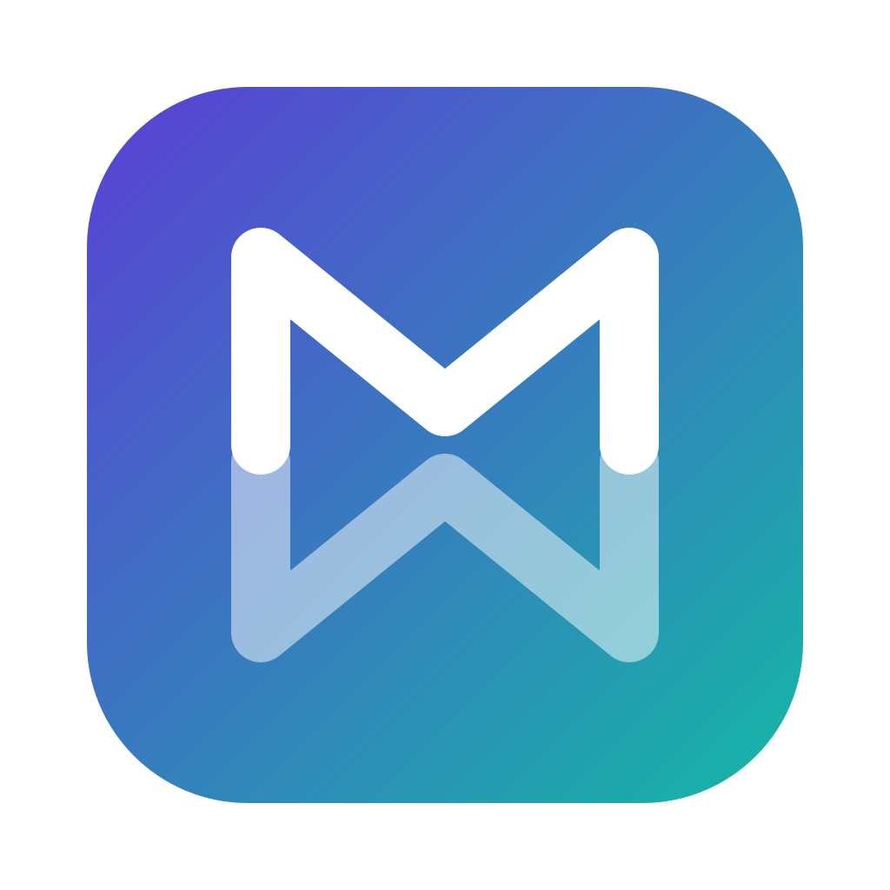

<p align="center">
  
</p>

<h1 align="center">Mirrorway</h1>

<p align="center">
  <b>One keyboard, one mouse, two computers — for Mac and Windows.</b><br>
  Use your Mac's keyboard and trackpad on a Windows PC on the same network, and watch the Mac's screen live on Windows.
</p>

<p align="center">
  <a href="https://github.com/fatihtanrivverdi/mirrorway/actions/workflows/ci.yml"></a>
  <a href="https://github.com/fatihtanrivverdi/mirrorway/releases/latest"></a>
  <a href="LICENSE"></a>
</p>

- **Keyboard and mouse sharing.** Push the pointer off the edge of the Mac's screen and it moves to Windows; push it back from the opposite edge on Windows and it returns to the Mac. Keyboard shortcuts work too.
- **Screen sharing.** The Mac's screen appears on Windows in a window or full screen, encoded with the Mac's hardware H.264 encoder.
- **Clipboard and files.** Text, formatted text (HTML, RTF), images, files and folders copied on one side can be pasted on the other.
- **Audio.** Whatever plays on the Mac can play through Windows's speakers.
- **Second screen.** A Windows monitor can become an extra display for the Mac (experimental).
- **Secure by design.** Devices are paired once with a 6-digit code (SPAKE2); every connection is authenticated with device keys and encrypted with AES-256-GCM. Mirrorway only accepts connections on networks you trust.

```
 ┌───────────── Mac (server) ──────────────┐         ┌──────── Windows (client) ─────────┐
 │ Mirrorway icon in the menu bar          │   TCP   │ Mirrorway icon in the tray        │
 │ keyboard/mouse capture ──── input ──────┼────────►│ applied with SendInput            │
 │ screen capture ─────── H.264 frames ────┼────────►│ "Mac screen" window               │
 │ clipboard ◄──── text, HTML, RTF, images ┼◄───────►│ clipboard                         │
 │ audio capture ───── 48 kHz PCM ─────────┼────────►│ default audio output              │
 └─────────────────────────────────────────┘  24850  └───────────────────────────────────┘
```

Mirrorway is written in Python. The Mac side runs on macOS 11 or later (audio needs macOS 13); the Windows side runs on Windows 10 and 11. The interface is in English and Turkish and follows the system language.

---

## 1. Installing on the Mac

1. Download **`Mirrorway-<version>-mac.dmg`** from the [latest release](https://github.com/fatihtanrivverdi/mirrorway/releases/latest) (Apple silicon: M1 or later), open it and drag **Mirrorway** onto **Applications**.
2. Open Mirrorway from Applications. The first time macOS refuses because the app is not signed by Apple: open **System Settings › Privacy & Security**, scroll down and click **Open Anyway** next to Mirrorway. This is needed once. The app brings its own Python; nothing else is installed.
3. macOS asks for these permissions. Grant them to **Mirrorway**, then quit Mirrorway and open it again:

| Permission | Where | What for |
|---|---|---|
| Accessibility | System Settings › Privacy & Security › Accessibility | Capturing the keyboard and mouse and hiding them from the Mac |
| Input Monitoring | … › Input Monitoring | Reading keystrokes |
| Screen & System Audio Recording | … › Screen & System Audio Recording | Streaming the Mac's screen and sound to Windows |

4. To pair Windows, click the **Mirrorway icon** in the menu bar and choose **Pair a New Device…**. A 6-digit code appears (valid for 3 minutes, single use).

Mirrorway starts by itself when you log in (Settings › General › Open at login) and updates itself from the releases here. The app code lives in `~/.mirrorway/app`, so updates do not change the app's signature and the permissions you granted stay in place.

> **Intel Macs, or without the disk image:** download `Mirrorway-<version>-mac.zip`, open it and run `install-mac.command`; it installs `~/Applications/Mirrorway.app` and uses a Python 3 installed on the Mac ([python.org](https://www.python.org/downloads/)). macOS blocks unsigned scripts downloaded from the internet: click **Open Anyway** in **System Settings › Privacy & Security**, or type `bash ` in Terminal, drag `install-mac.command` into the window and press Return. In a copy of the source code, `install-mac.command` builds `Mirrorway.app` itself (needs `xcode-select --install`); `run-mac.command` runs Mirrorway straight from the folder.

## 2. Installing on Windows

1. Download **`Mirrorway-<version>-windows-setup.exe`** from the [latest release](https://github.com/fatihtanrivverdi/mirrorway/releases/latest) and double-click it. The first time Windows may show "Windows protected your PC" (the installer is not signed): click **More info › Run anyway**.
2. That is all: the installer asks no questions. It installs Mirrorway with its own Python to `%LOCALAPPDATA%\Mirrorway` (no administrator rights, no separate Python), adds **Mirrorway** to the Start menu, the desktop and Windows startup, replaces an earlier Mirrorway or Köprü, and starts Mirrorway. Once, it asks for administrator permission for a firewall rule so the Mac is found automatically; saying No is fine (the Mac's address can be typed in Settings).
3. If this PC is not paired yet, the Settings window opens. On the Mac choose **Pair a New Device…** in the Mirrorway panel and type the 6-digit code. Pairing is done once; after that, connections are made automatically.
4. Click the Mirrorway icon in the tray (next to the clock; Windows may put it under **^** at first) to open the panel. The icon's colour shows the state: **violet** = connected, **teal** = the Mac's keyboard and mouse are on this PC right now, **grey** = not connected, **red** = error.

Later versions arrive by themselves: the Mac sends them to Windows when it connects. To uninstall, use **Settings › Apps › Installed apps › Mirrorway › Uninstall**; the settings in `%USERPROFILE%\.mirrorway` stay.

> The older zip package (`Mirrorway-<version>-windows.zip` with `install-windows.bat`) is still published; it uses a Python installed on the PC.

### Moving over from Köprü

Mirrorway was called Köprü until version 2.8. The downloads above replace it on both computers: Köprü is closed and removed, and its settings and pairing are carried over on first start, so there is no need to pair again. On the Mac, grant the permissions to Mirrorway and remove Köprü from the three permission lists.

## 3. Using Mirrorway

### The quick panel

Click the **Mirrorway icon** in the menu bar to open the quick panel:

- the connection status (network, latency, fps and video format),
- **Switch to Windows** / **Back to the Mac**,
- tiles that turn things on and off with one click: **Screen** (the Mac's screen window on Windows), **Second screen**, **Audio**, **Clipboard**, **Files** and **Wake Windows**,
- **Pair a New Device…**, **Network** (trust this network, home network only) and **Disconnect**,
- **Settings…** (`⌘,`) opens the Settings window; **right-click** (or Control-click) the icon for the full menu.

Quick shortcuts work anywhere, also while you control Windows:

| Shortcut | Action |
|---|---|
| `⌃ Control + ⌥ Option + S` | Show or hide the Mac's screen on Windows |
| `⌃ + ⌥ + D` | Second screen on or off (the monitor chosen last) |
| `⌃ + ⌥ + A` | Play the Mac's sound on Windows, or back on the Mac |
| `⌃ + ⌥ + M` | Open or close the quick panel |

Change the letters or turn a shortcut off in **Settings › General › Quick shortcuts**. To keep the classic menu on a left click, turn off **Clicking the icon opens the quick panel** there (or **Mirrorway › Click Opens the Quick Panel** in the menu).

### Settings

**Settings…** in the panel or the menu (`⌘,`) opens the Settings window. Its pages hold everything the menu has: **General** (the side of Windows, the screen edge, open at login, language, quick shortcuts, permissions), **Keyboard and Mouse**, **Screen and Video** (including the second screen), **Audio**, **Clipboard and Files**, **Network**, **Paired Devices** and **Updates** (with the diagnostics bundle). Changes apply at once.

### Switching to Windows and back

- **At the screen edge:** by default Windows is assumed to be on the **right** of the Mac. Push the pointer against the right edge of the Mac's screen to move to Windows; push it against the left edge of the Windows screen to come back. Change the side with **Mirrorway › Windows Is on This Side of the Screen**.
- **Shortcut:** `⌃ Control + ⌥ Option + →` switches to Windows, `⌃ + ⌥ + ←` returns to the Mac. The arrows follow the side you chose.
- After every switch a violet ring grows and fades for half a second where the pointer appears, on Windows and on the Mac, so you see at once which computer has it. Turn it off in Settings › General (on each computer separately).
- The edge does not switch near the corners, so the Mac's Hot Corners keep working.
- Right after switching, returning is briefly blocked: it is allowed again once the pointer moves away from the edge or after 0.8 seconds; to return, press gently against the edge. This stops the pointer from bouncing between the screens while your finger is still sliding on the trackpad.

### Trackpad gestures

While you control Windows, gestures on the MacBook trackpad act on Windows instead of the Mac:

| On the Mac trackpad | On Windows |
|---|---|
| 3 or 4 fingers left / right | The virtual desktop on the right / left (Win+Ctrl+→ / ←), as on macOS |
| 3 or 4 fingers up | Task View (Win+Tab), the counterpart of Mission Control |
| 3 or 4 fingers down | Show desktop (Win+D) |
| Pinch in / out | Zoom out / in (Ctrl + wheel) |

The Mac's desktop does not change and Mission Control does not open meanwhile. Two-finger scrolling goes to Windows as a wheel, as always. Turn this off with **Mirrorway › Trackpad Gestures on Windows**.

### Waking Windows (Wake-on-LAN)

While Windows sleeps, **Mirrorway › Wake Windows** wakes it from the Mac. The menu waits for Windows to wake up and connect, and shows the result.

- The PC's network adapter address is saved automatically the first time Windows connects; connecting once is enough.
- An **Ethernet cable** is recommended; most Wi-Fi adapters do not wake on a magic packet.
- One-time setting on Windows: **Device Manager › Network adapters ›** (the Ethernet adapter) **› Properties**.
  - On the **Power Management** tab, turn on *Allow this device to wake the computer* and *Only allow a magic packet to wake the computer*.
  - On the **Advanced** tab, set *Wake on Magic Packet* to **Enabled**.
- These are enough for sleep. If the PC is fully **shut down**, two more settings are needed:
  - *Control Panel › Power Options › Choose what the power buttons do*: turn off **Fast startup**.
  - In the BIOS/UEFI, turn on *Wake on LAN / Power on by PCI-E*.
- The settings Windows reports are written to the Mac log as a "Wake-on-LAN note". If waking fails, Mirrorway shows the missing setting there and in the warning window.

### The Windows tray panel

**Left-click** the Mirrorway icon in the Windows tray to open the panel above it: the connection status and which edge of the Mac's screen leads here, **Show the Mac's screen** / **Hide the Mac's screen** (`Ctrl + Alt + S` anywhere), and tiles for **Clipboard**, **Mac's sound** (turns the audio transfer on the Mac on or off), **Files**, **Reconnect**, **Pair a Mac** and **Diagnostics**. It follows the Windows light or dark app theme and closes when you click elsewhere or press Esc. Right-click the icon for the menu.

The gear in the panel (or **Settings…** in the menu) opens the Windows Settings window: **Connection** (status, the paired Mac, the 6-digit pairing code, the Mac's address, starting with Windows), **Mac screen** (the screen window, GPU decoding, measurements), **Audio**, **Clipboard and files**, **Shortcuts** (the letter for `Ctrl + Alt`) and **General** (language, logs, diagnostics).

### Watching the Mac's screen on Windows

Click **Show the Mac's screen** in the tray panel, press `Ctrl + Alt + S`, or right-click the tray icon › **Show the Mac's Screen**. On the Mac, `⌃⌥S` or the **Screen** tile opens and closes it too. In the window, **F11** or a **double-click** switches to full screen and **Esc** leaves it. In full screen the measurements (fps, bandwidth, target bitrate, latency) appear in the top right corner; **F9** shows or hides them. Choose the picture quality and which Mac display is shared in the Mac's menu.

The window draws with the graphics card (Direct3D 11), and the graphics card also decodes H.264 when it can. If these are not available, Mirrorway falls back to the window that decodes and draws on the processor (force it with `"viewer": "tk"` in `%USERPROFILE%\.mirrorway\windows.json`).

The picture is sent as **H.264** by default, using the Mac's hardware video encoder. It stays smooth when most of the screen changes (scrolling, video, moving windows) and uses little bandwidth. For the sharpest small coloured text, choose **Mirrorway › Video Format › JPEG**: JPEG sends only the regions that changed and uses more bandwidth when the whole screen changes.

| Quality | Width | H.264 (start; adaptive range) | JPEG |
|---|---|---|---|
| Low | 1280 px | 30 fps, 4 Mbit/s (0.8–8) | 12 fps |
| Medium | 1600 px | 30 fps, 8 Mbit/s (1–16) | 20 fps |
| High | 1920 px | 60 fps, 14 Mbit/s (1.5–30) | 30 fps |

With H.264 the bitrate and frame rate follow the connection: when Wi-Fi gets weak the picture keeps flowing at a lower quality instead of freezing, and when the connection is good and the screen is busy the quality goes up. Turn this off with **Mirrorway › Picture Quality › Adjust to the Connection Automatically (H.264)**.

### Clipboard

The clipboard syncs both ways automatically: plain text, formatted text (HTML and RTF) and images (screenshots included). Turn it off from the Mac menu or the Windows tray menu. Large images are sent in chunks, so the pointer does not stutter while copying. Images over 32 MB are not sent; the text still is.

Every transfer is logged on the Mac with its direction, formats and sizes (e.g. `Clipboard sent to Windows: text 12 B, image 240 KB (4 chunks, 9 ms)`); the copied content itself is never logged. Transfers and clipboard errors on Windows also appear in the Mac log as `Windows: [mirrorway.clipboard] …`.

### File copy and paste

Files and folders copied in Finder with ⌘C can be pasted in Explorer with Ctrl+V, and the other way round.

- The moment you copy, the content travels in the background over a separate encrypted connection. When it is complete it is put on the other side's clipboard and a notification appears; paste after that. The **File transfer** line in the Mac menu shows the progress.
- Folders go with their subfolders. Symbolic links are skipped. Characters Windows does not allow in names (`<>:"|?*`) become `_`.
- Folders with thousands of small files (a project, an app folder) are read and written by several threads at once and small files travel packed together, so they go nearly as fast as one large file. The log line of every transfer shows its speed and where the time went (disk or network).
- Incoming files are first written to a hidden "incoming" folder (`~/.mirrorway/incoming` on the Mac) and copied from there when you paste; the last three transfers are kept, older ones are deleted.
- The limits are 4 GB and 100,000 items (the size limit is the `file_clipboard_max_mb` setting on the Mac). A notification tells you when a copy could not be sent. Copying something new while a transfer is running abandons the old transfer.
- Turn it off with **Mirrorway › File Copy and Paste**; while it is off only the names of copied files go across, as text.

### Audio (the Mac's sound on Windows)

With **Mirrorway › Audio › Play the Mac's Sound on Windows**, everything that plays on the Mac (music, video, notification sounds) plays through Windows's default audio output. Mirrorway's own sounds are left out.

- The sound is captured the same way as the screen (ScreenCaptureKit); no extra permission is needed beyond **Screen Recording**. macOS 13 or later is required.
- It travels uncompressed as 48 kHz stereo (≈1.5 Mbit/s), which a home network handles easily. The delay is ≈60–100 ms. If the network stalls and sound piles up, the oldest is dropped so the sound never lags behind.
- **Mute the Mac's Speakers Meanwhile** (on by default): while the sound plays on Windows, the Mac's own output is muted, and unmuted when the transfer ends (when the connection drops or you turn it off). Even if Mirrorway crashes, it is unmuted on the next start. A Mac that was already muted is left alone.
- The **Status** line shows whether the transfer is working, or why not. The Mac log gets one line a minute: packets, sound level, Windows's queue and dropouts.

### A Windows monitor as the Mac's second screen (experimental)

Choose a Windows monitor in **Mirrorway › Second Screen (Windows monitor)**. The Mac opens a virtual display with that monitor's resolution, and the screen window on Windows goes full screen on that monitor to show it. You can drag windows there; the Mac's pointer and keyboard work there directly.

- **Position:** the virtual display is placed on the side where Windows is (**Mirrorway › Windows Is on This Side of the Screen**). You can move it in System Settings › Displays, but it is put back on that side every time it opens.
- **Moving to Windows:** if the monitor used as the second screen has another monitor next to it on Windows, the pointer moves to Windows from that edge of the virtual display, and moving towards that monitor on Windows brings it back to the same spot on the virtual display, so the monitors work where they stand on the desk. The other edges of the virtual display are walls. Returning from Windows's usual edge brings the pointer to the Mac's own display.
- **Windows with one monitor:** switching to Windows minimises the screen window; returning to the Mac brings it back.
- **Closing:** if the screen window on Windows is closed or the connection drops, the virtual display is removed after 20 seconds and macOS moves its windows to the main display. Choosing **Off** in the menu removes it at once.

The virtual display uses an undocumented macOS interface (DeskPad and BetterDisplay use it too), which a macOS update might break. That is why it runs in a separate helper process: if something goes wrong only that process stops, Mirrorway carries on and the menu shows the reason.

## 4. Keyboard mapping

Keys are sent by their physical position. If you choose the **same keyboard layout** on the Mac and on Windows, the characters come out the same.

| Mac | Windows (default) | Note |
|---|---|---|
| ⌘ Command | Ctrl | ⌘C / ⌘V / ⌘Z work as copy / paste / undo on Windows |
| ⌃ Control | ⊞ Win | If **Mirrorway › Keyboard › Cmd → Ctrl, Ctrl → Win** is turned off: ⌘ = Win, ⌃ = Ctrl |
| left ⌥ Option | Alt | For Alt+Tab, Alt+F4 and so on |
| right ⌥ Option | AltGr | Characters like **@ € # $ { } [ ] \ \|** (e.g. right ⌥ + Q = @ on a Turkish layout) |
| fn + ← / → / ↑ / ↓ | Home / End / PgUp / PgDn | |
| Volume and media keys | Windows volume and media keys | Only while controlling Windows |

> If you type characters like @ often on a layout that needs AltGr, turn on **Mirrorway › Keyboard › Left Option → AltGr (for @, € etc.)** so the left ⌥ works as AltGr too.

## 5. Troubleshooting

| Symptom | Fix |
|---|---|
| **!** next to the menu bar icon | The Accessibility and Input Monitoring permissions are missing. Choose **Mirrorway › Open Permission Settings**, grant them and restart Mirrorway. |
| Windows says "Looking for the Mac on the network…" | A firewall may block UDP 24851. Enter the address from the **This Mac** line in the *Mac address* field of the Windows settings. |
| "Wrong pairing code" | Get a new code with **Mirrorway › Pair a New Device…** (valid for 3 minutes; closed after 5 wrong attempts). |
| "This PC is not paired with the Mac" | The pairing was removed on the Mac. Get a new code on the Mac and enter it in the Windows settings. |
| Connects, then drops at once | If the macOS firewall is on, answer **Allow** when it asks whether Python (Mirrorway) may accept incoming connections (TCP 24850). |
| The screen window is black or shows an error | Grant Mirrorway the Screen Recording permission and restart it. |
| Some windows on Windows ignore clicks (Task Manager, installers) | Windows protects these administrator windows. Run Mirrorway on Windows as administrator. |
| Typing does not reach Windows while a password field is focused on the Mac | macOS "Secure Keyboard Entry" keeps keys from other apps. Leave the password field on the Mac. |
| The pointer is stuck on Windows | `⌃ + ⌥ + ←` always returns to the Mac. If the connection drops, control returns to the Mac automatically. |
| The pointer is too slow / fast on Windows | **Mirrorway › Pointer Speed (Windows)** |
| Artefacts or wrong colours in the picture | Try **Mirrorway › Video Format › JPEG**; the "H.264" lines in the Mac log show the cause. |
| **Wake Windows** does not work | See the Wake-on-LAN settings above. It usually does not work when Windows is on Wi-Fi. If nobody has logged in on Windows yet, Mirrorway connects only after login. |
| **⏸** next to the menu bar icon | Mirrorway is off on this network. See *Home network only* below. |

The logs are in `~/.mirrorway/` (on Windows `C:\Users\<name>\.mirrorway\`). For detailed output use `%LOCALAPPDATA%\Mirrorway\debug.bat` on Windows.

### Updates

The Mac side updates itself: once a day Mirrorway looks at this repository's latest release (no account needed), and **Mirrorway › Updates › Install … and Restart** installs a new version. Release packages are signed with Ed25519; a package whose signature, hash or version does not match is never installed. **Return to the Previous Version** brings the previous version back.

The Windows side updates itself through the Mac: when the Mac runs a newer version, Windows fetches it when it connects and restarts. The **Measurements** line in the Mac menu shows the latency and the screen stream's fps and MB/s.

### Security and paired devices

- A pairing code exists only after **Mirrorway › Pair a New Device…** and is valid for 3 minutes. Thanks to SPAKE2 the code cannot be guessed later even from recorded network traffic; 5 wrong attempts cancel it.
- Every device has a permanent key. On the Mac the private key is kept in the **Keychain**, on Windows encrypted with **DPAPI**; the settings files hold no secrets.
- **Mirrorway › Paired Devices** lists devices with their fingerprints; click one to remove its pairing, and its connection is cut at once and it cannot connect again.

### Home network only

Mirrorway recognises the Mac's network by the hardware address of its gateway and only accepts connections on trusted networks. The network you are on at first start is saved as the home network. At a café or at work Mirrorway turns itself off (**⏸** in the menu bar) and back on when you are home. Use **Mirrorway › Network** to trust another network or to turn the restriction off.

The hardware address is read from macOS's own network signature first, then from the ARP and IPv6 neighbour tables. If none can be read, Mirrorway recognises the network by the gateway's IP address only; the menu then shows **weak recognition**, and another network using the same addresses cannot be told apart from the home network.

### Diagnostics bundle

When something goes wrong, **Mirrorway › Create Diagnostics Bundle** (also in the Windows tray menu) collects the logs and settings into one zip on the Desktop. Pairing codes and device keys are never included.

## 6. Limitations

- Windows's lock screen, Ctrl+Alt+Del and UAC prompts run on the secure desktop; remote input cannot reach them.
- Files move by copy and paste; there is no drag and drop between the computers.
- Sound only goes from the Mac to Windows; Windows's sound and microphones are not transferred.
- Screen sharing is view only: Windows does not control the Mac (you already use the Mac's keyboard and mouse).
- The second screen is a video stream: its content reaches Windows with the same delay as the mirrored screen (≈15–20 ms).
- Both computers must be on the same local network.

## 7. Development

```
mirrorway/
  protocol.py, secure.py   handshake, pairing (SPAKE2), device keys, AES-GCM frames, message types
  keymap.py                macOS key codes -> Windows scan codes
  geometry.py              outer edge detection, entry points
  extend.py                second screen: monitor choice, virtual display position, crossings between the screens
  discovery.py             UDP discovery
  clipsync.py, richclip.py clipboard sync: format bundles, chunked transfer, CF_HTML and DIB conversions
  filexfer.py              file copy and paste: manifests, safe paths, a separate encrypted channel
  i18n.py, i18n_tr.py      interface language (English source texts, Turkish catalog)
  quick.py, prefs.py       quick panel and Settings window content, quick shortcuts (toolkit independent)
  assets/                  menu bar and Windows icons, the logo for the panel
  mac/                     router.py (input logic), tap.py (CGEventTap), capture.py, server.py, app.py (rumps),
                           panel.py + settings.py (quick panel, Settings window), vdisplay.py,
                           extend_mgr.py (second screen life cycle)
  win/                     remote.py (input logic), backend.py + winapi.py (SendInput), client.py, sdlview.py,
                           viewer.py, app.py (Tk + pystray), panel.py (tray panel), settings.py (Settings window),
                           hotkeys.py (Ctrl+Alt shortcuts), startup.py (start with Windows)
macapp/                    Mirrorway.app launcher (launcher.c), start.sh, build_app.py, icon
wininstaller/              the Windows installer (Inno Setup script; built by scripts/build_windows_installer.py)
assets/                    logo
scripts/                   release and packaging scripts
tests/                     unit and end-to-end tests (the Mac and Windows APIs are faked)
```

The tests run on any platform:

```
python -m pip install --require-hashes -r requirements-ci-linux.txt -r requirements-dev.txt
python -m pytest -q tests
```

Settings files: `~/.mirrorway/mac.json` and `~/.mirrorway/windows.json`. Dependencies are pinned by version and hash; update them with `scripts/pin_requirements.py`.

GitHub Actions runs pyflakes and the tests on Linux for every push and pull request. The real-platform runs (macOS and Windows) start from **Actions › CI › Run workflow** and on every release tag.

To release: update the version in `mirrorway/__init__.py` and `CHANGELOG.md`, then push a `v<version>` tag. Once all the tests pass, CI signs the update package with `MIRRORWAY_SIGNING_KEY` and publishes it on GitHub Releases together with the Mac and Windows download packages.

## License

[MIT](LICENSE). Mirrorway is an independent project and is not affiliated with Apple or Microsoft. Mac and macOS are trademarks of Apple Inc.; Windows is a trademark of the Microsoft group of companies.
